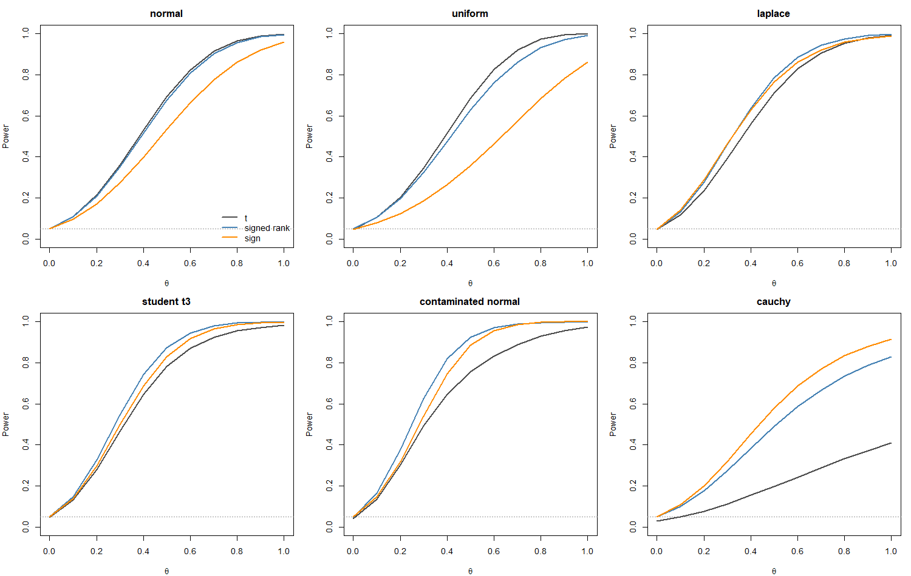
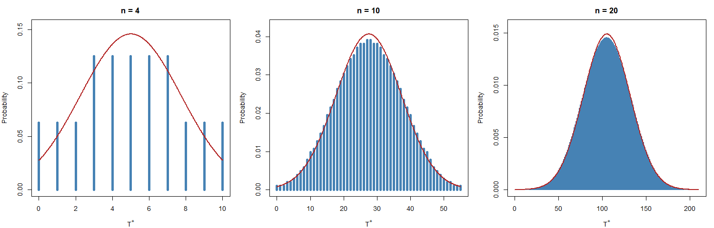
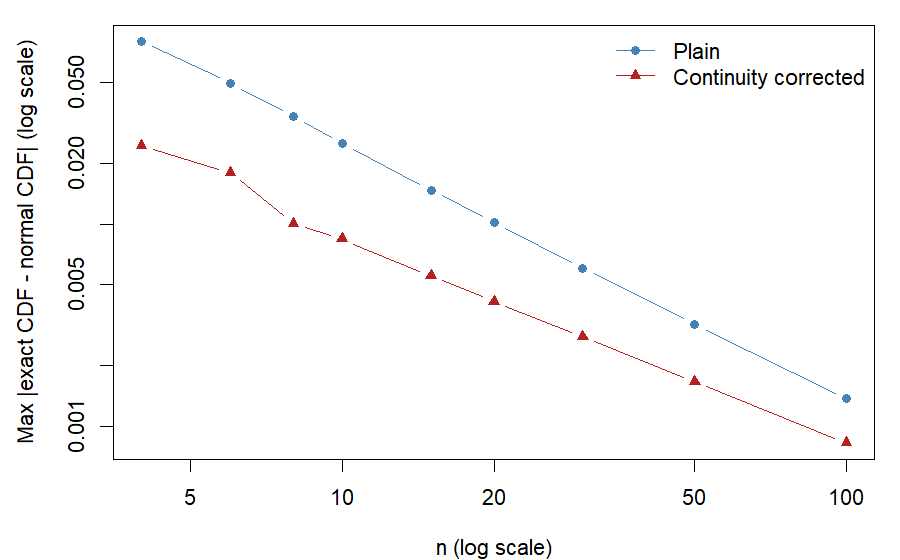

# Wilcoxon signed-rank test from scratch

An exact implementation of the Wilcoxon signed-rank test in base R, checked against `stats::wilcox.test`, plus a simulation study that asks a practical question: **when should you prefer a rank test over the t test?**



## What is inside

- The exact null distribution of $T^+$, computed in $O(n^3)$ by convolution instead of the exponential recursion.
- `signed_rank_test()`, which returns a standard `htest` object for two-sided and one-sided alternatives.
- A study of the normal approximation: how fast it converges and what a continuity correction buys.
- Size and power of the t, signed-rank and sign tests under normal, uniform, Laplace, Student $t_3$, contaminated normal and Cauchy errors.
- Pitman asymptotic efficiencies, computed numerically and compared with the finite-sample results.
- A [short derivation](docs/theory.md) of why the null distribution does not depend on the data distribution.

## Quick start

No packages needed, only R (developed with R 4.6.0). Run from the repository root.

```r
source("R/signed_rank.R")
x <- c(1.83, 0.50, 1.62, 2.48, 1.68, 1.88, 1.55, 3.06, 1.30)
y <- c(0.878, 0.647, 0.598, 2.05, 1.06, 1.29, 1.06, 3.14, 1.29)
signed_rank_test(x - y, alternative = "greater")
```

```bash
Rscript tests/run_tests.R
Rscript analysis/01_null_distribution.R
Rscript analysis/02_power_study.R        # about a minute
Rscript analysis/03_normal_n12.R
```

## Results

### Size and power, n = 20, one-sided test at 5%

40,000 replications per point. Discrete tests are randomised so that all of them aim at exactly the same size.

| Errors | Size: t | Size: signed rank | Size: sign | Power at θ = 0.5: t | signed rank | sign |
|---|---|---|---|---|---|---|
| Normal | 0.052 | 0.051 | 0.050 | **0.693** | 0.675 | 0.533 |
| Uniform | 0.050 | 0.050 | 0.049 | **0.684** | 0.627 | 0.358 |
| Laplace | 0.047 | 0.048 | 0.048 | 0.712 | **0.783** | 0.764 |
| Student t3 | 0.048 | 0.051 | 0.051 | 0.781 | **0.871** | 0.830 |
| Contaminated normal | 0.042 | 0.049 | 0.050 | 0.754 | **0.924** | 0.884 |
| Cauchy | 0.031 | 0.050 | 0.050 | 0.199 | 0.489 | **0.579** |

All distributions are centred at θ and have unit variance, except the Cauchy, which has no variance and is scaled to the interquartile range of a standard normal. The contaminated normal is a 90/10 mixture of N(0, 1) and N(0, 25), rescaled.

What stands out:

- Under normality, using ranks costs very little: about 2 points of power.
- With heavy tails the signed-rank test wins clearly, and the t test also stops holding its nominal size (0.031 under Cauchy).
- The signed-rank test is not always the best. With light tails (uniform) the t test is ahead, and under Cauchy the sign test is.

### Asymptotic relative efficiency against the t test

| Errors | Signed rank | Sign |
|---|---|---|
| Normal | 0.955 | 0.637 |
| Uniform | 1.000 | 0.333 |
| Laplace | 1.500 | 2.000 |
| Student t3 | 1.900 | 1.621 |
| Contaminated normal | 2.412 | 1.832 |

These are limits for large samples and nearby alternatives. They do not always predict the ranking at n = 20: under Laplace errors the sign test is asymptotically ahead of the signed-rank test, yet at θ = 0.5 it is slightly behind.

### Why the size has to match: normal errors, n = 12, θ = 1

| Test | Size | Power |
|---|---|---|
| z (known variance) | 0.050 | 0.966 |
| t | 0.050 | 0.945 |
| Signed rank (reject if T+ ≥ 61) | 0.046 | 0.929 |
| Signed rank, randomised | 0.050 | 0.935 |
| Sign (reject if S ≥ 10) | 0.019 | 0.706 |
| Sign, randomised | 0.050 | 0.812 |

About 11 points of the sign test's apparent weakness here come from its smaller size, not from the statistic itself.

### How good is the normal approximation?



The largest error in the CDF falls from 0.080 at n = 4 to 0.010 at n = 20. With a continuity correction it is 0.024 and 0.004.



## Layout

```
R/          exact distribution, test, power utilities
analysis/   scripts that produce every figure and table
tests/      checks against base R, theoretical identities and edge cases
results/    CSV output of the analysis scripts
figures/    plots
docs/       derivations
```

## Limitations

- The exact test assumes no tied absolute values. With ties the function stops and points to `stats::wilcox.test`.
- Zeros are dropped, which is one of several conventions.
- Power is studied for symmetric location models only. With skewed errors the signed-rank test is no longer a test about the median.

## Background and authorship

This started as my final project for a Statistics course at the University of Buenos Aires (December 2024), written together with Mariano Fernández Zaragoza and Juan Iñaki Larrea: the exact distribution, a first version of the test and the power comparison at n = 12.

I later rewrote and extended it (2026): faster computation of the null distribution, edge-case fixes (one-sided p-values when T+ = 0), a test suite, size-matched comparisons, the study across distributions and the efficiency analysis.
